# UX Design: Later?

This document walks through the user experience of **Later?**, a mobile web app that turns the places you find on social media into shared city lists your friends can vote on.

It covers the overall app map, the clickable prototype, and a screen-by-screen breakdown of every wireframe.

---

## Table of Contents

1. [Prototype](#prototype)
2. [App Map](#app-map)
3. [Wireframes](#wireframes)
   - [Onboarding](#1-onboarding): Sign Up, Login
   - [Home](#2-home)
   - [City Lists and Voting](#3-city-lists-and-voting): City List, Place Details, City List After Vote
   - [Joining a List](#4-joining-a-list): Accept Invite
   - [Adding a Place](#5-adding-a-place): Add Place, Place Found, Did You Mean?, Place Saved (Map), New City List Created
   - [Friends](#6-friends): Friends, Friend's Profile, Invite to List
   - [Profile and Settings](#7-profile-and-settings)

---

## Prototype

We built a clickable prototype in Figma that links the wireframes below into the app's main flows: signing up, pasting a link to save a place, voting on places in a city list, and inviting friends.

**[View the interactive prototype on Figma](https://www.figma.com/design/toSQgZiuKquuq6w6kcKQDQ/Later---Prototyping?node-id=0-1&t=6DHOSBXcIZvGeJzC-1)**

## App Map

The app map shows how users move between screens. After signing up and logging in, everything branches from **Home**. The bottom navigation bar (Home, Map, Create, Friends, Settings) is available on all main screens.

  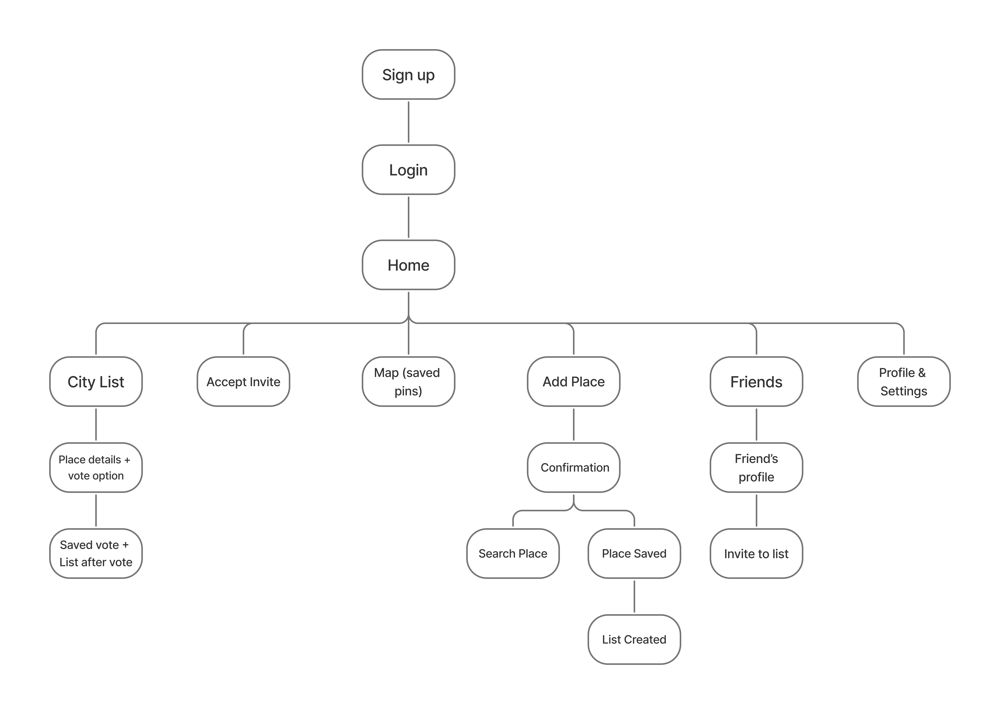

## Wireframes

### Navigation bar

Most screens share a bottom navigation bar with five tabs:

| Tab | Goes to |
| --- | --- |
| **Home** | The Home dashboard |
| **Map** | The map of saved pins for a city |
| **Create** | The Add Place screen (this is the main action, so the button is larger) |
| **Friends** | The Friends list |
| **Settings** | Your profile and settings |

---

### 1. Onboarding

#### Sign Up

  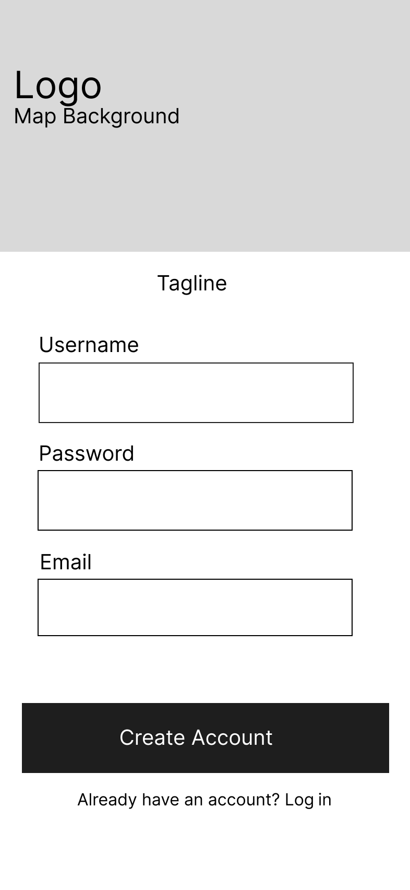

**Purpose:** Lets a new user create an account with a username, password, and email.

- The **username** is important. Friends find and invite each other by `@username`, so it must be unique.
- The header will show a map background behind the logo to set the tone of the app.
- "Already have an account? Log in" links to the Login screen.

#### Login

  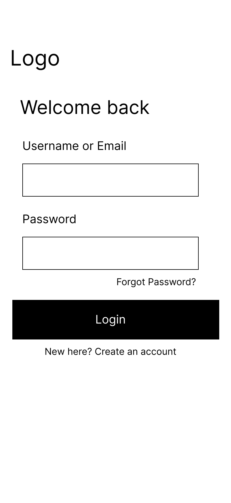

**Purpose:** Lets a returning user sign in.

- Users can log in with **either their username or their email**.
- "Forgot Password?" starts a password reset.
- "New here? Create an account" links back to Sign Up.

---

### 2. Home

  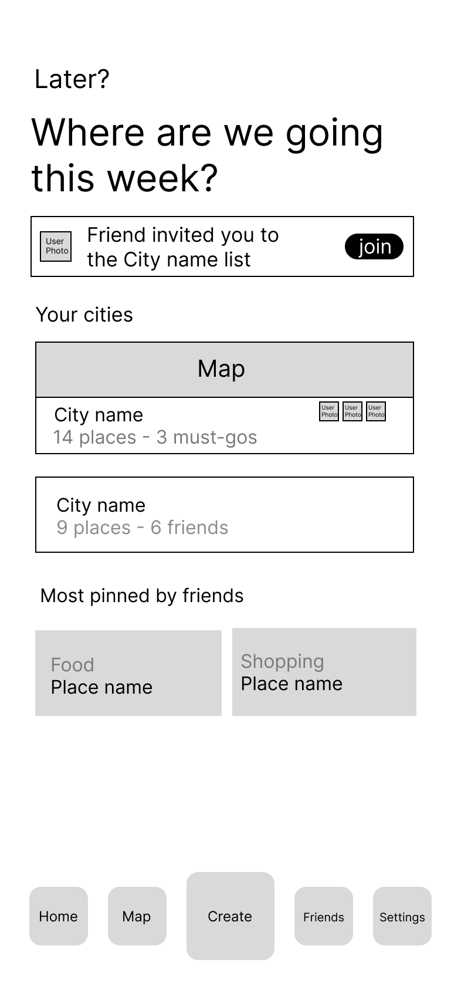

**Purpose:** The user's dashboard. It answers the question "Where are we going this week?" by showing their city lists, pending invites, and what their friends are saving.

- **Invite banner:** If a friend has invited the user to a city list, a banner appears at the top. Tapping **join** opens the [Accept Invite](#accept-invite) screen.
- **Your cities:** Each city list the user belongs to is shown as a card with a quick summary (number of places, number of must-gos, or number of friends) and the photos of the friends on that list. The first card includes a map preview. Tapping a card opens that [City List](#city-list).
- **Most pinned by friends:** Shows the places saved most often across the user's friends, labelled by category (Food, Shopping, etc.), so users can see what everyone is excited about.

---

### 3. City Lists and Voting

#### City List

  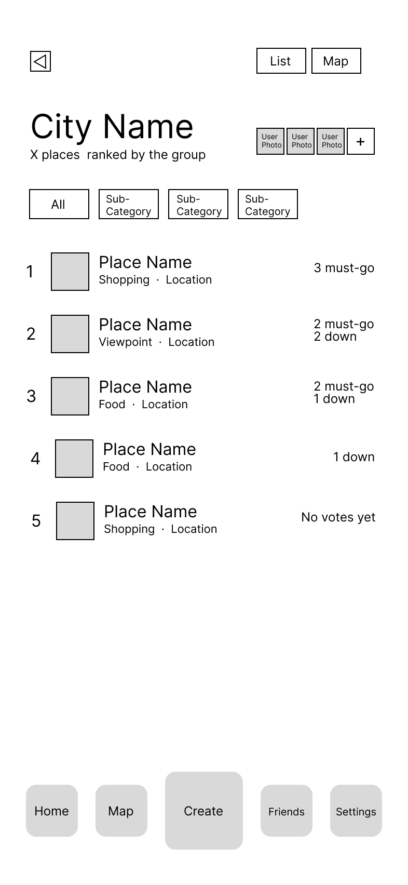

**Purpose:** Shows every place saved to one city, **ranked by the group's votes**. This is where friends decide what's actually worth doing.

- **Ranking:** Places are ordered by their votes. "Must-go" votes count the most, then "down for it." Places nobody has voted on sit at the bottom with "No votes yet."
- **Category filters:** The chips under the title (All, plus sub-categories like Food, Shopping, Viewpoint) filter the list.
- **List / Map toggle:** Switches between this ranked list and the [map view](#place-saved-map-view) of the same city.
- **Member photos and +:** Show who is on this list. The **+** button opens [Invite to List](#invite-to-list).
- Tapping a place opens its [Place Details](#place-details).

#### Place Details

  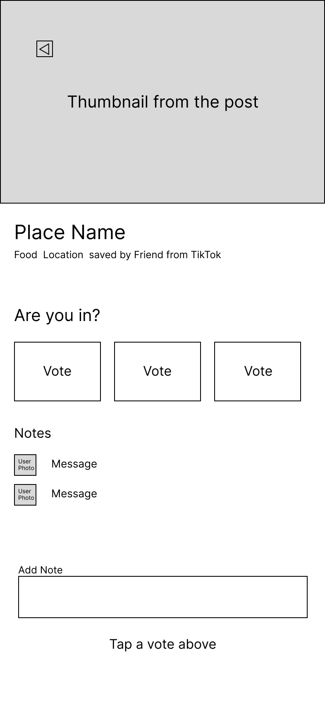

**Purpose:** Shows everything about one saved place and lets the user vote on it and leave a note for the group.

- **Thumbnail and source:** The image comes from the original social media post. The subtitle shows the category, location, **who saved it, and which platform it came from** (e.g. "saved by Friend from TikTok").
- **"Are you in?" voting:** Three vote buttons: **Must-go**, **Down for it**, and **Hard pass**. A user can only cast one vote per place, and can change it later.
- **Notes:** Friends can leave short comments explaining their vote (e.g. "it's a 40 min walk from the subway").
- **Add Note:** A note is attached to the user's vote, so the hint "Tap a vote above" reminds users to vote before posting a note.

#### City List After Vote

  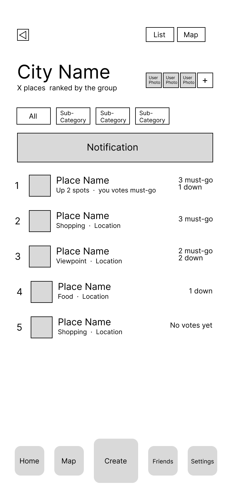

**Purpose:** Shows the City List updated right after the user votes, so they can see the effect of their vote.

- A **notification banner** confirms the vote was saved.
- The list **re-ranks immediately**. The place the user voted on shows how far it moved and how they voted (e.g. "Up 2 spots · you voted must-go").

---

### 4. Joining a List

#### Accept Invite

  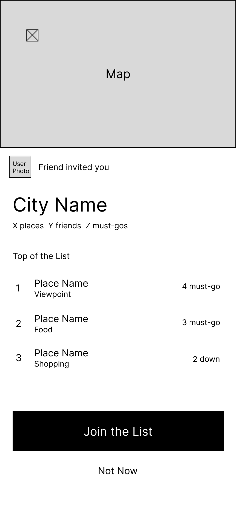

**Purpose:** Lets a user preview a city list a friend invited them to before deciding to join.

- Shows who sent the invite, a map preview, and a summary of the list (number of places, friends, and must-gos).
- **Top of the List** shows the group's three highest-ranked places so the user can see what they're signing up for.
- **Join the List** adds them as a member and opens the City List. **Not Now** dismisses the invite without joining.

---

### 5. Adding a Place

This is the core flow of the app: paste a link, and Later? figures out the place, saves it to the correct city list, and puts it in front of your friends.

#### Add Place

  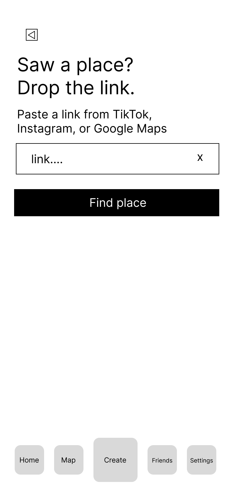

**Purpose:** The starting point for saving a place. Opened from the **Create** button in the navigation bar.

- Users paste a link from **TikTok, Instagram, or Google Maps**. The **x** clears the field.
- **Find place** sends the link to be processed. The app reads the post and tries to identify the place automatically. The user does **not** need to type the place name or pick a list.

#### Place Found (Confirmation)

  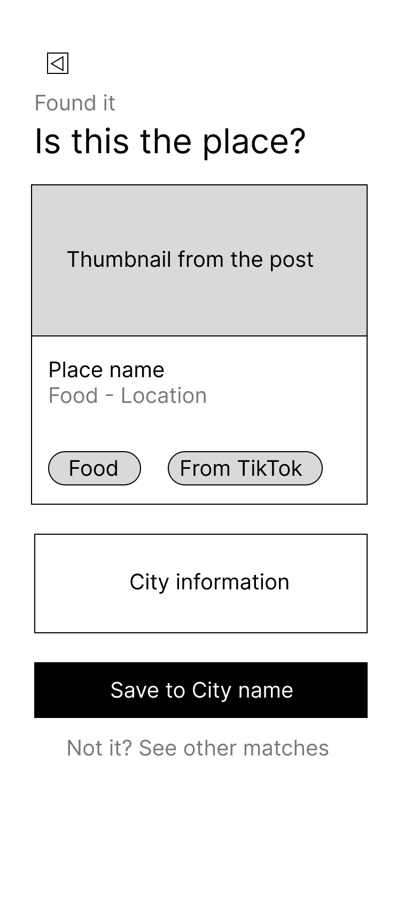

**Purpose:** Shown when the app is confident it identified the place. The user confirms it with a single tap.

- The card shows the post's thumbnail, the place name, and **tags generated automatically** for the category (e.g. Food) and source (e.g. From TikTok).
- **City information:** The app works out which city the place is in from its location.
- **Save to [City name]** saves the place directly to that city's list. If the user doesn't have a list for that city yet, one is created for them (see [New City List Created](#new-city-list-created)).
- **"Not it? See other matches"** opens the [Did You Mean?](#did-you-mean-search-place) screen.

#### Did You Mean? (Search Place)

  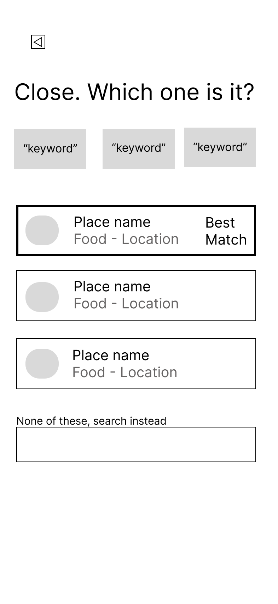

**Purpose:** The fallback when the app can't confidently identify the place from the link, or when the user says the first match was wrong.

- **Keyword chips** show the words the app pulled from the post (e.g. caption text, hashtags), so the user can see why these results came up.
- A list of possible matches, with the most likely one highlighted as **Best Match**. Tapping a match selects it and saves it.
- **"None of these, search instead"** lets the user search for the place manually by name. The following screen is not part of our MVP.

#### Place Saved (Map View)

  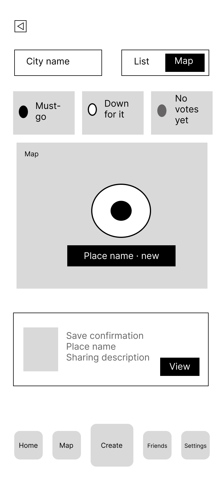

**Purpose:** Confirms the place was saved and shows the new pin on the city's map. This is also the **Map** screen that users reach from the navigation bar or the List/Map toggle.

- **City name** selector at the top switches between the user's city lists.
- **Pin legend:** Pins are styled by the group's vote: **Must-go** (filled), **Down for it** (outlined), and **No votes yet** (grey). This lets users see at a glance what the group wants and what's near them.
- A newly saved place is labelled **"new"** on the map.
- The **save confirmation card** at the bottom shows the place and who it's been shared with. **View** opens its [Place Details](#place-details).

#### New City List Created

  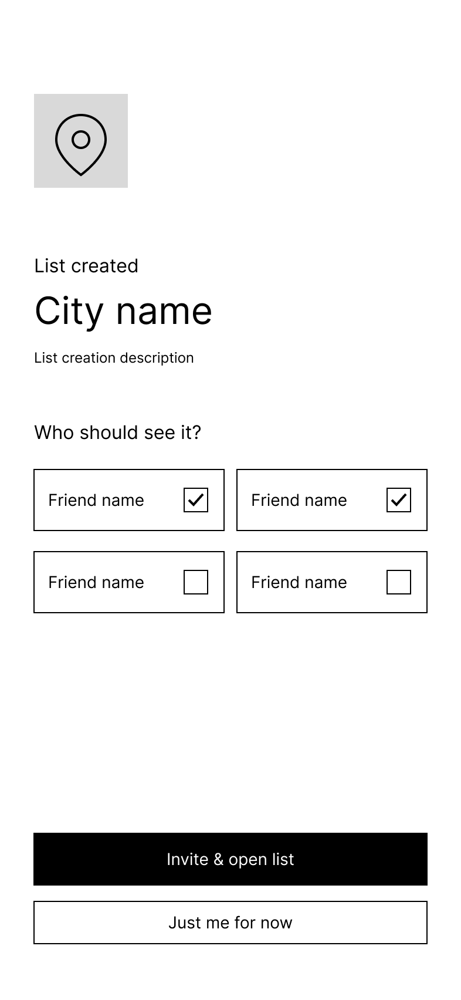

**Purpose:** Shown when the user saves their first place in a city they don't have a list for yet.

- **Users never create lists manually.** Lists are created automatically by city as soon as a place in a new city is saved.
- **"Who should see it?"** lets the user pick which friends to invite to the new list right away.
- **Invite & open list** sends the invites and opens the City List. **Just me for now** keeps the list private, and friends can be invited later.

---

### 6. Friends

#### Friends

  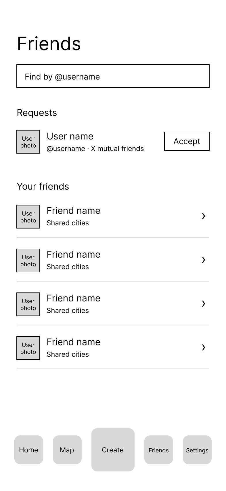

**Purpose:** Lets users find new friends, respond to friend requests, and see their current friends.

- **Find by @username:** Search for other users by their unique username.
- **Requests:** Incoming friend requests, with mutual friend counts to help users recognize people. **Accept** adds them as a friend.
- **Your friends:** Each friend shows the cities you share lists in. Tapping a friend opens their [profile](#friends-profile).

#### Friend's Profile

  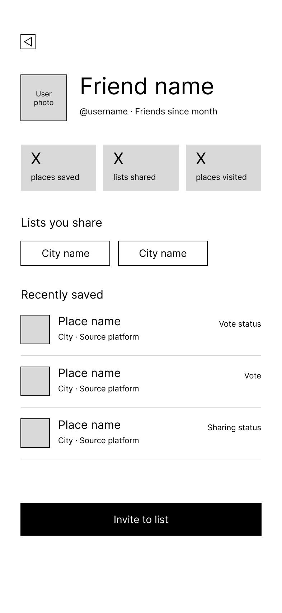

**Purpose:** Shows a friend's activity and the lists you have in common.

- **Stats:** places saved, lists shared, and places visited.
- **Lists you share:** Tap a city to open that City List.
- **Recently saved:** The friend's latest saves, with the city, the platform they came from, and the current vote or sharing status.
- **Invite to list** opens [Invite to List](#invite-to-list) so you can add this friend to one of your city lists.

#### Invite to List

  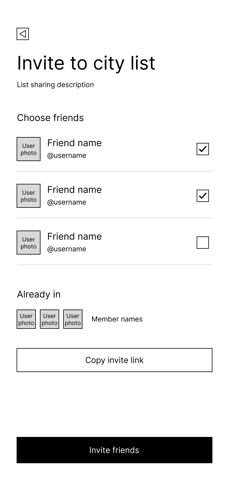

**Purpose:** Lets a user invite friends to one of their city lists.

- **Choose friends:** Check the friends to invite.
- **Already in:** Shows current members so you don't invite someone twice.
- **Copy invite link:** Creates a shareable link for friends who aren't on Later? yet, or to paste into a group chat.
- **Invite friends** sends the invites. Invited friends see the banner on their Home screen and the [Accept Invite](#accept-invite) screen.

---

### 7. Profile and Settings

  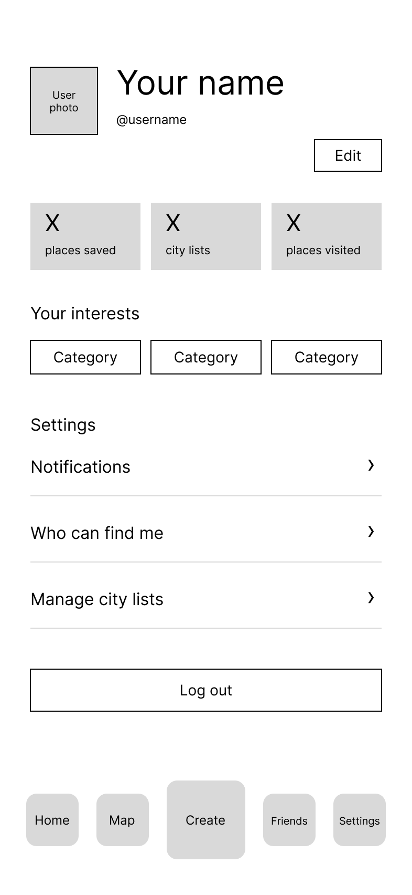

**Purpose:** The user's own profile and account settings. Opened from the **Settings** tab in the navigation bar.

- **Edit** changes the user's name, photo, and username.
- **Stats:** places saved, city lists, and places visited.
- **Your interests:** The categories the user is most interested in (e.g. Food, Shopping, Viewpoint).
- **Settings:**
  - **Notifications:** Control alerts for new places, votes, and invites.
  - **Who can find me:** Control whether other users can find you by username.
  - **Manage city lists:** Leave lists or remove places from them.
- **Log out** signs the user out and returns them to the Login screen.
