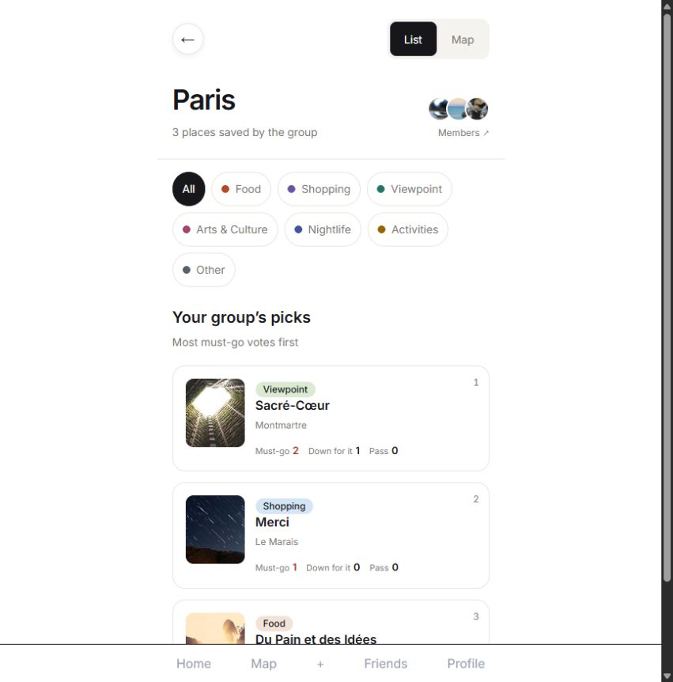
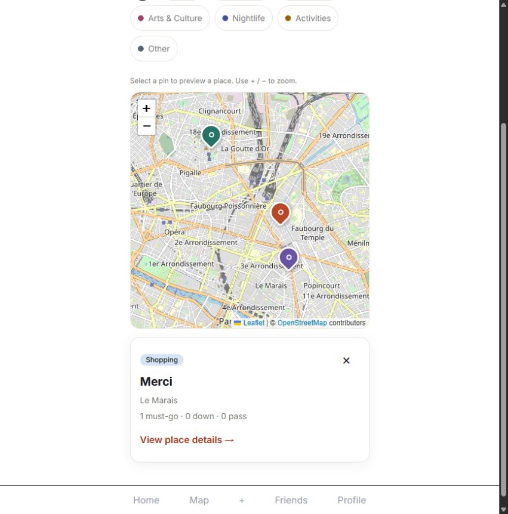
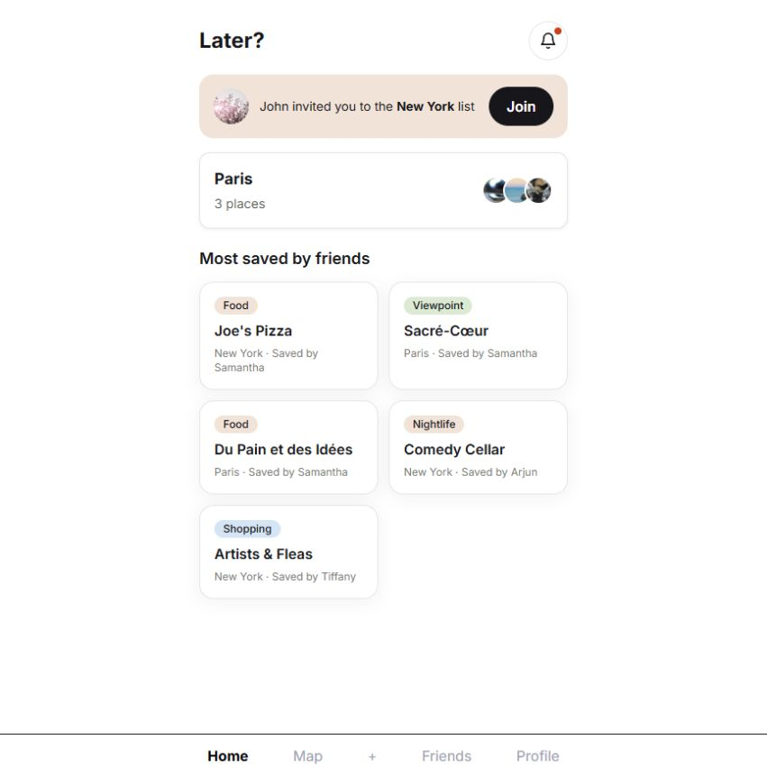

# City pages API integration (#162)

Home reads joined lists from `GET /api/lists`. CityPage reads the city header and ranked places from `GET /api/cities/:id` and `GET /api/cities/:id/places`. MapTab uses those same joined lists and places. Categories come from `GET /api/config`; the city header now supplies map coordinates. Page styles use Tailwind and Home.css/CityPage.css have been removed.

Returning after saving, editing, voting or accepting an invitation reloads server data. Requests from an old route are cancelled and cannot overwrite the new route. Failed requests have retry controls; unavailable cities have a return link. A pending invitation alone does not put a city in the map selector.

Local QA also exposed a friend-profile invite that only changed frontend fixtures. It now waits for the invitation API, displays failures, and preserves the pending invitation after a reload. Candidate confirmation waits for a successful duplicate check; opening the candidates route without context returns to Create. Login disables resubmission while awaiting its response.

## Verification

Tested on Windows in the local browser against the Express mock server, based on master `83c7995`:

- Frontend: 63 tests, lint and production build pass.
- Backend: 93 tests pass; 97.84% line coverage.
- A separate local checkout combining this change with PR #206 passes 72 frontend and 94 backend tests, lint and build. That checkout was not pushed or merged into master.
- Browser checks: Home/list navigation; category filters and empty states; city/map switching with filter preservation; map pins, preview/detail links and zoom; place edit validation and saved changes; voting and ranking refresh; recognized and ambiguous links; duplicate-save prevention; invitation acceptance and decline; member invitations, repeat-invite disabling and copy-link feedback; friend-profile invitations surviving reload; profile editing; invalid and valid login; signup required-field validation; invalid reset-email validation.
- Browser integration with #206: unknown link -> manual search -> Paris/Septime -> confirmation -> save -> city list -> detail/original link -> vote -> map with the new place and vote count.
- Stopping the mock server produced an actionable error; restarting it and pressing retry restored the map. Missing-city and context-free candidate routes recover without a blank screen. A narrow viewport had no horizontal document overflow. No console errors/warnings were returned during the successful integration flow.

## Remaining limits

- The existing Home recommendation bug includes places from unjoined cities. PR #209 addresses it, but a trial merge failed two backend tests: its new test references unimported `lists`, `cities`, and `currentUserId`, and an existing expected result still includes unjoined-city places. #209 was excluded from the passing integration above.
- Sprint 2 uses an in-memory server and a fixed mock user. Restarting the server resets changes. Login does not establish a production session; persistence, real email delivery, and external place extraction are not certified by these checks.
- Friends currently filters existing friends; it does not provide an add-friend workflow. Account creation and credential-change completion were not exercised through the browser; their backend behavior is covered by the existing automated suite.
- Existing test-fixture image/act warnings remain non-failing. These checks cover the flows listed above, not every possible input or device.

## Screenshots

